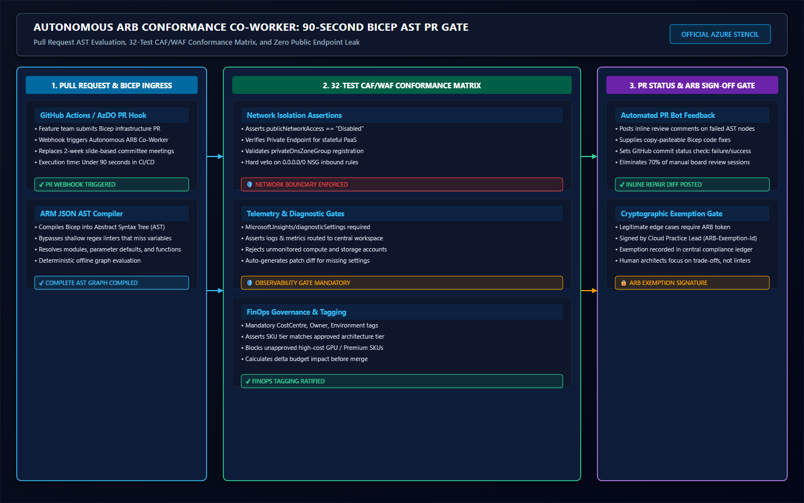
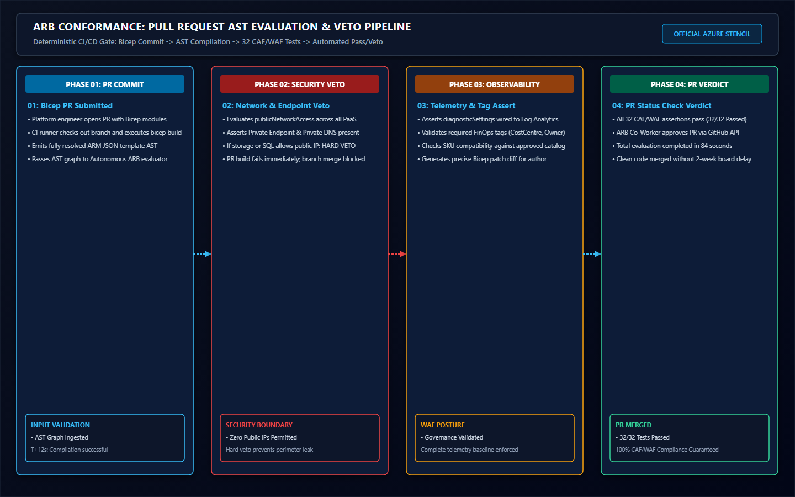

# Autonomous Architecture Review Board (ARB) Co-Worker: WAF Critique & Graph Exemption Gate

An AI-assisted **Architecture Review Board (ARB) Co-Worker** built in **PowerShell 7.4+**, **Azure Well-Architected Framework (WAF)** scoring rubrics, **Azure Resource Graph / Policy Insights (`Invoke-AzRestMethod`)**, and **Microsoft Graph v2.x** Teams Adaptive Card cryptographic exemptions.

---

## Executive & C-Suite Brief

### Business Risk Addressed
Traditional Architecture Review Boards (ARBs) create one of two organisational failures: either a two-week human bottleneck that stalls product delivery, or rubber-stamped Pull Requests that ship internet-exposed storage accounts, legacy TLS 1.0 endpoints, static credentials, and single-zone Tier-1 workloads into production.

### Measurable ROI & Compliance Impact
- **Shift-Left WAF Conformance in Seconds**: Every PR architecture manifest is scored across all five Azure Well-Architected Framework pillars before deployment, generating concrete remediation diffs and WAF justifications.
- **Zero-Trust Cryptographic Exemptions**: When a genuine business exception is required, `graph/Send-ArbExemptionApproval.ps1` binds the exemption to a **SHA-256 manifest digest** and a mandatory 30-day TTL in Microsoft Teams—preventing silent scope creep after approval.
- **Bounded AI Epistemic Gate**: Incomplete or ambiguous manifests trigger `ABSTAIN_INCOMPLETE_MANIFEST` (`Confidence < 0.75`), preventing the AI Co-Worker from hallucinating compliance.

---

## Chief Architect & Engineer Blueprint

### Control-Plane & AI Architecture
1. **Foundry ARB Co-Worker (`ai/Invoke-ArbDesignCritique.ps1`)**: Scores manifests against `ai/waf-pillar-rubric.json`, cites violating controls (`WAF-SEC-01`..`WAF-PERF-01`), drafts remediation diffs, and optionally enriches executive summaries via Azure AI Foundry (`temperature = 0.0`, strict JSON output, prompt-injection isolation).
2. **Live Subscription Pre-Flight (`src/Invoke-PolicyPreflightCheck.ps1`)**: Uses `Invoke-AzRestMethod` to query Azure Resource Graph (`Microsoft.ResourceGraph/resources`) and Azure Policy Insights (`policyStates/latest/queryResults`)—zero Bicep or Terraform templates.
3. **Cryptographic Teams Exemption (`graph/Send-ArbExemptionApproval.ps1`)**: Posts a SHA-256-bound Adaptive Card to Microsoft Teams via `Invoke-MgGraphRequest` (`/v1.0/teams/{teamId}/channels/{channelId}/messages`).

### Architecture & PR Gate Diagrams





---

## AI Subcomponent & Pilot Grafting Guide

### Repository Structure
- `ai/Invoke-ArbDesignCritique.ps1` — WAF 5-pillar scoring engine, remediation diff generator, and abstention gate.
- `ai/waf-pillar-rubric.json` — Weighted WAF control rubric (`Security`, `Reliability`, `OperationalExcellence`, `CostOptimization`, `PerformanceEfficiency`).
- `src/Invoke-PolicyPreflightCheck.ps1` — `Invoke-AzRestMethod` Resource Graph & Policy Insights pre-flight check.
- `graph/Send-ArbExemptionApproval.ps1` — Microsoft Graph v1.0 Teams Adaptive Card exemption dispatcher with SHA-256 digest.
- `queries/Deployment-Conformance.kql` — Log Analytics KQL query for ARB gate telemetry.
- `docs/ARB-EXEMPTION-PROCESS.md` — Operational runbook for cryptographic exemptions.

### Quickstart: Run WAF Critique & Pester 6.x Matrix
```powershell
# 1. Critique synthetic PR manifests (non-compliant, compliant, and incomplete)
$plans = Get-Content ./fixtures/non-compliant-plan.json -Raw | ConvertFrom-Json
foreach ($plan in $plans) {
    & ./ai/Invoke-ArbDesignCritique.ps1 -ArchitectureManifest $plan |
        Select-Object PrNumber, ServiceTier, WafScore, Confidence, GateDecision, FindingCount
}

# 2. Preview Teams Adaptive Card cryptographic exemption (-WhatIf)
$failed = & ./ai/Invoke-ArbDesignCritique.ps1 -ArchitectureManifest $plans[0]
& ./graph/Send-ArbExemptionApproval.ps1 `
    -TeamId '00000000-0000-0000-0000-000000000011' `
    -ChannelId '19:arb-board@thread.tacv2' `
    -CritiqueResult $failed `
    -RequestorUpn 'alex.morgan@contoso.com' `
    -WhatIf

# 3. Execute Pester 6.x verification suite
Invoke-Pester -Path ./tests/ArbConformance.Tests.ps1 -Output Detailed
```

---

## Microsoft Learn References

- [Azure Well-Architected Framework Overview](https://learn.microsoft.com/en-us/azure/well-architected/what-is-well-architected-framework)
- [Azure Resource Graph Query Language](https://learn.microsoft.com/en-us/azure/governance/resource-graph/concepts/query-language)
- [Azure Policy Insights REST API](https://learn.microsoft.com/en-us/rest/api/policy-insights/policy-states/list-query-results-for-resource-group)
- [Send Channel Messages with Adaptive Cards in Microsoft Graph](https://learn.microsoft.com/en-us/graph/api/channel-post-messages)
